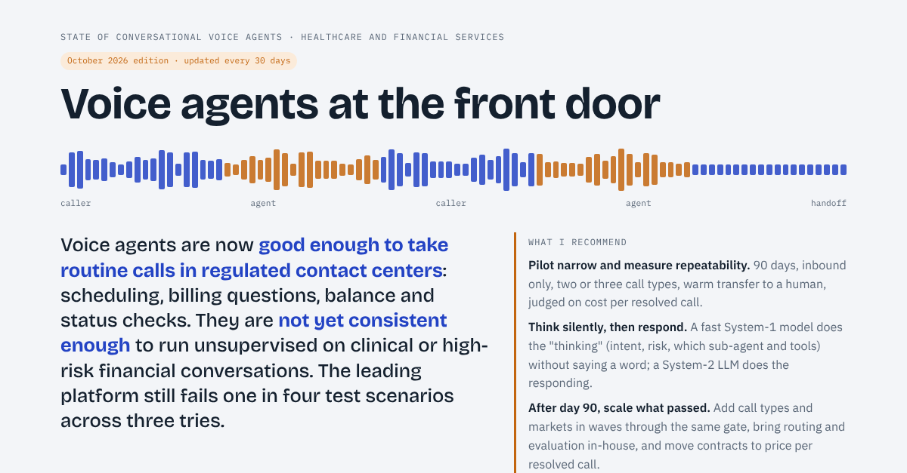

# State of Voice Agents

An interactive, vendor-neutral look at conversational voice agents in regulated contact centers: healthcare first, with notes for financial services. It is published as a monthly edition and updated every 30 days.

**Read it:** https://sbmadhav.com/state-of-voice-agents/



## Current edition: October 2026

Three theses:

1. **Reliability is the gap.** A single demo overstates readiness by 20 to 40 points. Measure repeatability (pass^3) on your own call types.
2. **Think silently, then respond.** A fast System-1 "thinker" makes silent, typed decisions: intent, risk, which sub-agent and which MCP tools. A conversational LLM "responder" does the talking.
3. **Invest in governed memory.** Build a governed fact store now; it pays off with retrieval today. Limited Memory Language Models, which look facts up instead of memorizing them, are promising but research-stage: trial one on a single domain and scale only if it beats retrieval.

The page is in two parts:

- **Part I, for executives:**
  - A one-minute read and a ten-minute executive summary (nine points: reliability, evaluation, the thinker-responder model, hearing the right caller, emotion and persona, governed memory, identity, economics, the 90-day pilot) and a "How to read this report" note on method, limits and disclosure.
  - Reliability benchmark with its margin of error, published results, and an economics model with escalation costs, repeat calls and worst, expected and best cases.
  - The thinker-responder router demo, where to start, and trust and identity.
  - Limited-memory models, the options, and a 90-day pilot with a plan for after day 90.
  - A seven-seat debate.
- **Part II, for architects and engineers:**
  - Architecture, latency budget and pass^k measurement.
  - Failure modes, routing models compared, and how LMLM works.
  - Deployment posture, fraud controls, regulation, a claim check and the full source list.

Every figure links to its source. Vendor-reported numbers are labeled as such.

## Features

- Interactive charts and tools, each tagged "Interactive".
- **Ask Bolt:** a Q&A assistant grounded in the report, with optional web research. See [worker/README.md](worker/README.md) to switch on live answers.
- Daybreak (light) and Deep Space (dark) schemes. The page follows the reader's device setting by default; the sun/moon button in the site header switches it, like on every sbmadhav.com page.
- **Download PDF** reformats the page for letter-size pages in the theme the reader chooses: tabs and filters are expanded and controls are hidden.

## Editions

| Edition | Link | Notes |
|---|---|---|
| October 2026 | [editions/2026-10](https://sbmadhav.com/state-of-voice-agents/editions/2026-10/) | First edition |

The root `index.html` always holds the latest edition. Each month's edition is also archived under `editions/YYYY-MM/`. See [UPDATING.md](UPDATING.md) for the monthly checklist and [CHANGELOG.md](CHANGELOG.md) for what changed.

## About

Part of [sbmadhav.com](https://sbmadhav.com/) and styled with its design system. By Madhav Srinivasan. Written in a personal capacity; not affiliated with any organization or vendor named. Outcome figures are customer- or vendor-reported unless marked otherwise. Regulatory summaries are not legal advice.

Corrections and source suggestions are welcome as GitHub issues.

## How it is served

GitHub Pages publishes this repo (branch `main`) as a project site, and the custom domain of [sbmadhav/sbmadhav.github.io](https://github.com/sbmadhav/sbmadhav.github.io) puts it at `/state-of-voice-agents/`. The page is plain HTML with no build step. A `.nojekyll` file tells Pages to publish every file as is, so everything committed here is public.

The Explore menu, analytics and fonts come from the main site (`/assets/`) by absolute URL. The styling, the type scale and the site header come from a pinned version of the sbmadhav.com design system ([sbmadhav/design-system](https://github.com/sbmadhav/design-system)), `/design-system/v/2.1.0/`; the header is composed into each page with the design system's `compose.py` and committed (see `CLAUDE.md`, which also lists what every page must keep).

## Run locally

To see the page with the site chrome, serve this checkout with the rest of the site proxied from sbmadhav.com:

```sh
node e2e/local-server.mjs 8126
```

Then open http://localhost:8126/state-of-voice-agents/.

## Checks

There is no build. `.github/workflows/design-system.yml` checks that every page's header matches the pinned design-system header and loads the pinned files, and `.github/workflows/e2e.yml` runs the Playwright tests. Before publishing, check every changed number against its source, test light and dark themes, a phone-width screen and Download PDF, and for a new edition follow [UPDATING.md](UPDATING.md).

## Contributing

`main` is protected: every change from someone else arrives as a pull request, needs the owner's review, and nothing merges without approval. Corrections, sources and page fixes are welcome. See [CONTRIBUTING.md](CONTRIBUTING.md) for how to propose a change, and [SECURITY.md](SECURITY.md) to report a security problem privately.

## License

The code (page scripts, interactive tools, `worker/`) is [MIT](LICENSE). The report itself is licensed under CC BY 4.0: share and adapt it with credit to Madhav Srinivasan. Linked sources, quoted figures and vendor names belong to their owners. Details are in [LICENSE-CONTENT.md](LICENSE-CONTENT.md).

## Thank you, Claude

Built with Claude: much of this report and its interactive tools were researched, designed and written together with Claude, Anthropic's AI assistant, through Claude Code. Thank you, Claude.
